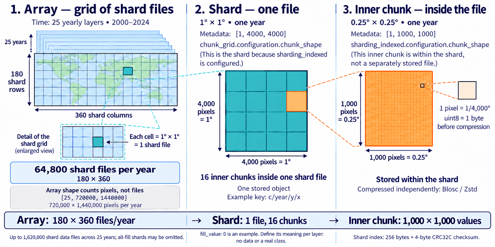
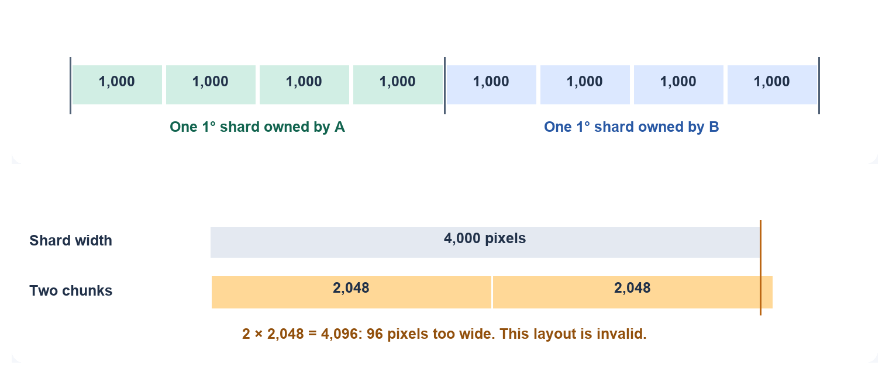

# A shared spatial standard for raster ingestion and comparison

**Status: proposal for discussion.** This document brings together improvements 1–3 in [improvements.md](improvements.md): the definition of the lattice, the processing tiles, and the storage chunks and shards. They form one spatial contract, which should be defined before changing the source store or the execution model.

The objective is to define **two permanent, nested analysis grids**. Every raster admitted to an analysis grid must use its exact cell boundaries, indexing and coordinates. For a given grid and area, every layer then has the same rows, columns and cell footprints, regardless of its source, year, ingest date or processing run. Comparing layers becomes an operation on corresponding cells.

Between the two grids, the cell counts differ by a fixed factor: each `L4000` cell contains exactly nine `L12000` cells. That relationship is part of the standard too.

## Motivation

### The current grid exists implicitly

The pipeline already harmonizes rasters onto EPSG:4326 at 1/4000° per cell. Its definition is distributed across the implementation:

| Component                     | Current responsibility                                             | Limitation                                                               |
| ----------------------------- | ------------------------------------------------------------------ | ------------------------------------------------------------------------ |
| `tiling.TileResolution.GLAD`  | Defines 40,000 × 40,000 pixels per 10° tile.                       | The spatial standard is expressed through one source's tile dimensions.  |
| `harmonize.Grid`              | Builds an EPSG:4326 transform from a tile's north-west corner.     | Origin, extent and resolution conventions are coupled to 10° processing. |
| Dataset adapters              | Crop, mosaic or warp sources into ingest tiles.                    | Each adapter must reproduce the intended spatial conventions.            |
| `geo.validate_geotiff`        | Checks CRS, dtype, positive dimensions and transform direction.    | Does not check exact lattice alignment, cell spacing or tile bounds.     |
| `geo.get_chunk_size`          | Chooses a power-of-two chunk from a memory budget and band dtypes. | Block boundaries depend on the stack and need not divide a tile evenly.  |
| `emit.get_hectares_per_pixel` | Infers spacing from coordinates and estimates area using latitude. | Grid geometry and cell area are reconstructed downstream.                |

`geo.exact_merge` already requires identical coordinates when combining datasets. This is useful, but it checks agreement between those datasets rather than proving that each follows an independently defined global standard. Two equally shifted layers could agree with one another while violating the intended grid.

### Choose the standard from the source grids

Most of the main 30 m layers already share the same grid: EPSG:4326 at 1/4000°, with cell edges on whole degrees. This is the case for Hansen tree-cover loss, GLAD land cover, Harris aboveground biomass, GNW peatlands and GPW grassland. The other layers use a different resolution or projection and must be resampled once: GACED30 and Descals oil palm (1/3710.65°, Earth Engine's "30 m"), USDA CDL (30 m in Albers), SoilGrids (250 m in Homolosine), Huang belowground biomass (1/120°), GPW livestock (1 km in Homolosine), MapSPAM (1/12°) and the IPCC climate zones (1/2°).

### A common grid exists, but it is not defined or checked

The pipeline already puts every layer on a common grid of 1/4000° before combining them. The problem is how that grid exists:

- **it is never clearly defined**: the documentation describes it in one sentence ("EPSG:4326 at 0.00025°, tiled on the 10° graticule"), but without saying where it starts, whether coordinates mark cell centres or corners, or how cells are numbered. The code has no definition either: it only knows that a 10° tile is 40,000 pixels wide, and reads each tile's position from its name (e.g. `20N_090W`), so each step rebuilds the grid from these two pieces. And the stored Zarr files do not record it at all: they keep only lists of coordinates, without even the coordinate system, which the reading code adds back by assumption;
- **layers are aligned at different moments**: some when they are ingested, others later, each time the harmonized stack is rebuilt;
- **nothing checks the result**: a layer is accepted as long as it has the right number of rows and columns.

This matters because the same number of pixels, or the same "30 m" label, does not guarantee that pixels cover the same ground. A layer shifted by half a pixel still has 4,000 × 4,000 pixels. Huang belowground biomass is a real case: its coordinates are read as pixel centres when they are probably pixel corners, so the layer lands about one pixel away from its true position, and nothing in the pipeline notices. When two shifted layers are overlaid, each pixel is compared with its neighbour, which creates false disagreements between maps, or false changes between years, along every field and forest edge.

The standard keeps the same grid but makes it explicit: the grid is written down once, every layer is aligned to it **once** at ingest, and the result is **checked**. After that, any step can ask for "this tile" and get exactly the same pixels from every layer, with nothing left to align or resample. A common grid only makes layers comparable pixel by pixel; differences in definitions, units, years or coverage still have to be handled separately.

### No grid exists for finer sources

Today there is, implicitly, one grid of about 30 m, and nothing finer. A 10 m source, such as a Sentinel-2-based map, has no defined target: it would either be degraded to 30 m, losing most of its detail, or brought in on its own grid, which would not line up with the other layers.

### Work and storage units are too large and not aligned

The unit of work is the 10° tile: 1.6 billion pixels per band. A single task needs a large machine, runs for hours, and loses all its work if it fails.

Storage blocks are not aligned with the tiles either. Their size is computed from the number of bands, so it changes when a band is added: today it is 2,048 × 2,048 pixels for the main stack of 56 bands, but 16,384 × 16,384 for a stack of one band. And 2,048 does not divide a tile evenly: a 10° tile of 40,000 pixels holds 19 full blocks plus a partial one of 1,088 pixels, and a degree of 4,000 pixels is not a whole number of blocks either, so block edges never fall on degree lines. As long as each tile is written to its own store, this goes unnoticed; once neighbouring tiles are written into one shared array, two workers would have to write the same block.

## Proposed spatial contract

### 1. Define two versioned global grids

| Property                     | `L4000`            | `L12000`           |
| ---------------------------- | ------------------ | ------------------ |
| Coordinate reference system  | WGS 84, EPSG:4326  | WGS 84, EPSG:4326  |
| Cells per degree, `N`        | 4,000              | 12,000             |
| Exact angular cell size      | 1/4000°            | 1/12000°           |
| Informal scale               | Approximately 30 m | Approximately 10 m |
| Global columns, `W = 360N`   | 1,440,000          | 4,320,000          |
| Global rows, `H = 180N`      | 720,000            | 2,160,000          |
| Cells in a 1° shard          | 4,000 × 4,000      | 12,000 × 12,000    |
| Cells in a 0.25° chunk       | 1,000 × 1,000      | 3,000 × 3,000      |
| Spatial chunks in a 1° shard | 4 × 4              | 4 × 4              |



**Why these two grids.** `L4000` is the grid the pipeline already uses, and the one the main 30 m layers are published on, so their pixels are kept as they are. `L12000` is its finer sibling for future 10 m sources: each `L4000` cell is exactly 3 × 3 `L12000` cells, with the same origin and the same degree lines. Two fixed grids give every current and future source a target, without creating a new grid for each dataset.

The grids are defined in degrees. "About 30 m" and "about 10 m" are only approximations: a cell gets narrower towards the poles, and a source published on a true 10 m grid in metres will still need to be reprojected onto `L12000`.

The standard fixes the following conventions:

- Cell edges lie on multiples of `1/N` degrees, so both grids pass through the graticule origin `(0°, 0°)`.
- The global indexing origin is the north-west corner `(-180°, 90°)`.
- Columns increase eastward; rows increase southward. Arrays use spatial dimension order `(y, x)`.
- Coordinates are interpreted as longitude and latitude respectively. Library axis handling must preserve that convention.
- Cells represent areas; GeoTIFF exports declare `AREA_OR_POINT=Area`. The affine transform refers to outer edges, while xarray coordinates refer to cell centres.
- Grid definitions carry a version, for example `L4000-v1`. Changing origin, spacing, indexing or ownership conventions creates a new grid version.

The global shape describes the address space. It does not require allocating or writing every cell. Regional and sparse stores may contain only covered windows, provided their global offsets and grid identity are explicit.

### 2. Make cell addresses unambiguous

For column `I` and row `J`, with `0 <= I < W` and `0 <= J < H`:

```text
west edge    = -180 + I/N
north edge   =   90 - J/N
centre lon   = -180 + (I + 1/2)/N
centre lat   =   90 - (J + 1/2)/N
cell_id      = J*W + I
```

A full cell reference is `(grid_id, cell_id)`, or equivalently `(grid_id, I, J)`. A numeric ID alone is insufficient because the two grids have different widths. IDs require a 64-bit integer representation at these global dimensions.

Use half-open cell footprints:

```text
longitude: [west, east)
latitude:  (south, north]
```

A shared vertical edge belongs to the cell on its east; a shared horizontal edge belongs to the cell on its south. This implements ownership of each cell's west and north edges without double counting. Treat `+180°` as `-180°` when assigning a point; do not create a duplicate dateline column. The exact south pole is outside the half-open cell domain and should be rejected by point-to-cell lookup. Geographic windows crossing the dateline are split into two integer windows.

Generate coordinates directly from integer indices using the rational definition. Do not accumulate floating-point steps or derive a new grid from a requested bounding box. Floating-point coordinates are an interchange representation of the standard, rather than its definition.

### 3. Fix the relationship between the grids

A coarse cell `(I, J)` contains the fine cells:

```text
fine columns: 3I, 3I+1, 3I+2
fine rows:    3J, 3J+1, 3J+2
```

Conversely, a fine cell's parent is `(I_fine // 3, J_fine // 3)`. All parent edges coincide with fine-cell edges. The coarse-cell centre also coincides with the centre of its middle child.

Because the two grids share the same origin and their ratio is a whole number (3), comparing a layer on one with a layer on the other needs no reprojection, only a reshape of the array:

- **Fine → coarse:** group the fine pixels in blocks of 3 × 3 and summarize each block (mean for a density, majority for a class, sum for a total). In xarray it's one line: `coarsen(x=3, y=3)`.
- **Coarse → fine:** repeat each coarse value into its 3 × 3 block. That doesn't create new information, it just puts the coarse value on the fine layout.

This only works with a whole-number ratio. A grid of 10,000 cells per degree, for example, would be 2.5 times finer than `L4000`: some fine cells would straddle two coarse cells, and comparing them would again require resampling.

The ratio is recorded in the grid metadata of each file (for example "`L12000`, parent `L4000`, ratio 3"), so a reader comparing two files knows immediately how to line them up. Chunks line up too: a 0.25° chunk is 1,000 pixels on `L4000` and 3,000 on `L12000`, so chunk *k* of one file covers exactly the same ground as chunk *k* of the other, and the two can be compared chunk by chunk, in parallel, without loading whole layers.

This eliminates geometric ambiguity between the two grids, but moving values between them still requires a declared rule:

| Quantity                                    | Coarse to fine                                                                           | Fine to coarse                                                                                     |
| ------------------------------------------- | ---------------------------------------------------------------------------------------- | -------------------------------------------------------------------------------------------------- |
| Class or mask                               | Replicate the parent if that is the intended interpretation.                             | Use a declared rule such as majority, any, all or class fractions. Define ties and missing values. |
| Intensive value, such as carbon per hectare | Replicate for a piecewise-constant interpretation; record any alternative interpolation. | Use an area-weighted mean over valid children.                                                     |
| Extensive value, such as total emissions    | Allocate the parent total by an explicit rule, such as child area fractions.             | Sum child totals.                                                                                  |

Replication creates no new observations. A coarse estimate represented on the fine grid retains its original effective resolution. Preserve that information in metadata so the finer array is not mistaken for finer evidence.

### 4. Standardize the 1° work tile

A 1° tile holds 16 million pixels per band instead of 1.6 billion for a 10° tile: the unit of work becomes 100 times smaller, so tasks fit on small machines, finish in minutes, are cheap to retry, and spread evenly across workers.

Define 360 tile columns and 180 tile rows, independently of raster resolution:

```text
0 <= tx < 360
0 <= ty < 180
id     = x{tx:03d}y{ty:03d}
west   = -180 + tx
north  =   90 - ty
extent = [west, west+1) × (north-1, north]
```

For grid `N`, a tile occupies the integer window:

```text
columns: [tx*N, (tx+1)*N)
rows:    [ty*N, (ty+1)*N)
```

For example, `x279y082` covers longitude 99°E–100°E and latitude 7°N–8°N on both grids. It has 4,000 rows and columns on `L4000`, and 12,000 on `L12000`.

Within the same grid, a cropland layer and a forest-loss layer requested for that tile must return identical spatial coordinates and dimensions, even if one covers only part of the tile. Missing coverage is represented by a mask and declared missing-value semantics, rather than by shifting or shrinking the cell layout.

Publisher tiles remain acquisition units. A 10° source tile can feed 100 work tiles without changing the analysis addresses. Country boundaries select intersecting work tiles and mask their cells; they never establish a country-specific origin.

A 1° tile is a scheduling and retry unit, not a requirement to hold its entire stack in memory. Processing remains chunked. `L12000` has nine times as many cells per tile, so its worker memory and runtime must be measured separately. Skip a tile only when the relevant coverage or land mask proves it has no work; an absent storage object alone does not establish this.

### 5. Align chunks and shards with tiles

Use spatial chunks of 0.25° and spatial shards of 1°. Each tile contains 16 spatial chunks, and no spatial shard crosses a work-tile boundary. Chunk and shard dimensions are derived from the grid definition, independent of the number of layers.

Each level has one role: **cells** say where things are, **tiles** are the units of work, **chunks** are the blocks that are read and compressed, and **shards** group chunks into one storage file. Because each level divides the one above it exactly, a tile is always a whole number of chunks and one shard.



**A concrete example: two neighbouring shard files at 7–8°N.** The footprint `x279y082` covers 99–100°E, and `x280y082` covers 100–101°E. Each footprint corresponds to one spatial shard per array and temporal shard block. Each shard contains 4,000 × 4,000 cells on `L4000`. Here, “tile” names the geographic processing footprint of a shard; it is not another object inside Zarr.

With 1,000 × 1,000 inner chunks, four chunks fit along each side of a shard. Those 16 chunks are stored in that shard's file. Worker A exclusively writes shard A; worker B exclusively writes shard B. No chunk belongs to both files.

The reason to choose 1,000 rather than 2,048 is **exact divisibility**. The [Zarr sharding codec](https://zarr-specs.readthedocs.io/en/latest/v3/codecs/sharding-indexed/index.html#configuration-parameters) requires each inner chunk dimension to divide the corresponding shard dimension evenly. `4,000 / 1,000 = 4`, whereas `4,000 / 2,048` is not an integer. Two 2,048-pixel chunks would require 4,096 pixels. That configuration cannot be used for a 4,000-pixel shard; chunks do not overflow into another shard or become shared between files.

With one exclusive writer per shard, neighbouring workers do not write the same storage object. The reason for the 1,000-pixel chunk size is compatibility with the fixed 1° shard and a predictable read granularity. Other exact divisors are possible; 1,000 is the proposed choice because it gives 0.25° chunks and 16 spatial chunks per shard. Concurrent writes would require coordination if several workers were assigned to the same shard, regardless of inner chunk size.

A fully populated global layer has 1,036,800 spatial chunks, grouped into 64,800 spatial shards for each stored temporal block. These are layout counts, not predictions of written objects: sparse coverage may omit fill-only shards, while additional time blocks create additional objects.

A 0.25° float32 chunk contains about 4 MB on `L4000` and 36 MB on `L12000`, before compression and temporary computation buffers. Memory planning must account for concurrent chunks, bands and time slices.

For time-dependent arrays, declare both temporal chunk depth and temporal shard depth. A shard spanning several years makes its entire temporal block part of one writer's responsibility. Temporal layout is a storage choice; it must preserve the spatial addresses defined here.

Zarr v3 sharding groups independently encoded inner chunks within a storage object. Its [sharding specification](https://zarr-specs.readthedocs.io/en/latest/v3/codecs/sharding-indexed/index.html) describes index-based access and shard updates. Request counts depend on the reader, caching and access pattern, so this proposal does not promise a fixed number of requests per read.

Assign one active writer to each `(array, spatial tile, temporal shard block)`. Create shared array metadata before dispatching workers, and prevent overlapping retry attempts from writing simultaneously. A completion marker is written only after the output region succeeds. Shard alignment establishes disjoint ownership across neighbouring tiles; removing `COMPUTE_LOCK` also requires checking the remaining scheduler, metadata and retry interactions.

### 6. Declare the grid in the Zarr metadata

A Zarr store is a folder. Next to the data, each group and each array has a small JSON file, `zarr.json`, with an `attributes` section that can hold any metadata. That is where the grid should be written.

**What happens today.** A store only carries `x` and `y` coordinate arrays: one longitude per column and one latitude per row. A reader must work out the grid from these numbers: the cell size from the gap between two values, the origin from the first value. This is fragile:

- the values are floating-point numbers, so `0.00025` is never stored exactly;
- nothing says whether a value marks the centre or the corner of a cell, and mixing the two shifts the layer by half a cell;
- the CRS is not stored in the file; the code that reads it assumes EPSG:4326.

**What we propose.** The grid is **declared once**, in the attributes of the store's root group, and never inferred:

```json
{
  "zarr_format": 3,
  "node_type": "group",
  "attributes": {
    "proj:code": "EPSG:4326",
    "spatial:dimensions": ["y", "x"],
    "spatial:transform": [0.00025, 0, -180.0, 0, -0.00025, 90.0],
    "lattice": {
      "name": "L4000",
      "version": 1,
      "cells_per_degree": 4000,
      "origin": [-180, 90],
      "pixel_convention": "area"
    }
  }
}
```

- `proj:code` gives the coordinate system.
- `spatial:transform` gives the position of the top-left corner and the size of a cell, in the usual GDAL order. It refers to cell **edges**, not centres.
- `lattice` names the grid and its version, so a reader can check that two stores use the same one by comparing a name instead of comparing numbers.

The `proj:` and `spatial:` keys follow the GeoZarr conventions being prepared at the OGC, so other tools can read them.

**Each array** then only describes what is specific to it:

```json
"attributes": {
  "units": "Mg/ha",
  "fill_value_meaning": "no_data",
  "source": "gnw/harris-agb@v1.4",
  "resampling": "none"
}
```

**Keep `x` and `y`, but as a convenience.** xarray and QGIS expect them, so they stay in the store. They are computed from the grid definition (cell centres), not the other way round, and the conformance check verifies that they agree with the declared transform.

The rule is simple: **a reader takes the grid from the metadata, it never reconstructs it from the coordinates.**

### 7. Enforce the contract at raster ingestion

Each dataset adapter declares its target grid, source interpretation and any permitted transformation. Ingestion has two explicit paths:

1. **Already conforming:** verify the source against the target grid, then copy or window it without resampling. Values and valid-data masks must be preserved.
2. **Transformation required:** reproject or resample deliberately onto a target window derived from integer grid indices. Record the operation, then apply the same conformance checks to its output.

Do not accept a layer based only on a “10 m” or “30 m” label. Check its actual CRS, affine transform, shape and bounds.

| Source situation in this project                                       | Proposed treatment                                                                                                                   |
| ---------------------------------------------------------------------- | ------------------------------------------------------------------------------------------------------------------------------------ |
| GLAD and Hansen inputs expected to match the existing analysis lattice | Verify each release's metadata against `L4000`; preserve samples when it conforms.                                                   |
| GPW grassland ingest already targets the GLAD resolution               | Verify output alignment and separately establish whether acquisition preserved native samples.                                       |
| GACED30                                                                | Its adapter already resamples publisher tiles onto the GLAD target. Record this transformation and check the result against `L4000`. |
| CDL and Descals oil palm                                               | Their adapters already map sources onto the GLAD target. Declare the method and verify `L4000` output.                               |
| Future finer-resolution imagery or thematic maps                       | Target `L12000` when justified; verify native alignment or record reprojection.                                                      |
| Coarse sources such as MapSPAM, livestock, biomass or soil layers      | Retain source resolution and grid metadata; define an explicit analytical conversion or aggregation before cellwise comparison.      |

The two grids are the standard **fine analysis targets**. Keeping an original coarse source is compatible with this proposal, but that source is not directly cell-comparable with a fine-grid layer until a relationship has been established.

MapSPAM's 1/12° spacing and the current EPSG:4326 livestock ingest's 1/120° spacing divide `L12000` evenly: 1,000 and 100 fine cells per side respectively. Neither divides `L4000` evenly. Spacing alone does not prove nesting: origins and coverage edges must also align. The livestock publisher's native raster is projected, so the 1/120° grid is already a derived product.

One-degree and quarter-degree boundaries can provide common aggregation windows for aligned coarse grids without expanding their values into fine cells. Avoid treating coarse totals as per-fine-cell totals: replication would multiply their sum.

### 8. Define conformance as a checkable result

Before publishing a standardized raster, verify:

- **Identity:** declared grid ID and version, with the intended EPSG:4326 interpretation.
- **Orientation:** north-up, positive x spacing, negative y spacing and no rotation or shear.
- **Spacing:** both absolute steps equal `1/N` within the standard's numerical tolerance.
- **Origin:** the outer top-left corner corresponds to integer global cell indices.
- **Extent:** dimensions and bounds match the declared integer window and remain inside the global domain.
- **Coordinates:** centres are generated by the canonical index formula and are consistent with the transform.
- **Coverage:** valid data, uncovered cells and unprocessed regions have distinguishable meanings.
- **Transformation record:** whether values were copied or transformed, with source grid, method and processing identity.

Use a documented, versioned tolerance measured in cell units. A proposed starting value is `1e-6` of a cell, to be checked against real source metadata before adoption. Check corner and far-edge residuals, not just the top-left corner, because a small spacing error can accumulate across a large raster. A failed check reports the mismatch and refuses publication; it must not silently fix a half-cell shift by relabelling coordinates.

On successful ingest, record the grid ID, global window, source resolution, transformation and coverage information. Downstream reads verify these declarations and compare canonical integer windows. The contract applies equally to COG or Zarr storage; adopting a shared raw store is a subsequent change.

### 9. Derive cell area from the grid

Compute cell areas from their parallel and meridian boundaries on the WGS 84 ellipsoid. All cells in one row have the same area, so a one-dimensional area-per-row array is sufficient and can be broadcast when needed.

This replaces inferring spacing from coordinate differences and applying the current circumference-and-cosine approximation. The area calculation must use the actual angular cell footprint; a polygon routine that connects corners with geodesics should not be assumed to represent the same parallel-bounded footprint exactly.

Both grids use one area definition. The sum of the nine children's areas must match their parent's area within numerical tolerance. Area-weighted comparisons and conversion of per-hectare emissions to totals then share the same geometry. Changing the area calculation can change reported hectare and emissions totals, so evaluate and report that effect separately from the storage and tiling migration.

## What comparison becomes

For two layers on `L4000`, a request for `x279y082` produces two 4,000 × 4,000 windows with identical cell footprints. Their common valid-data mask defines the comparison domain. Counts, disagreements and differences can be calculated directly, with no additional spatial alignment.

For an `L12000` layer compared with an `L4000` layer over the same tile, the fine window has 12,000 × 12,000 cells. Apply the declared 3 × 3 reduction to the coarse footprints, or the declared coarse-to-fine expansion. Record that choice as part of the comparison. The geometry is fixed; the meaning of the aggregation remains a scientific decision.

For repeat runs, the same `(grid_id, tile_id, local row, local column)` always identifies the same ground footprint. A changed value can therefore be traced to inputs or methodology without also reconstructing a run-specific grid.

The same holds between **two separate Zarr files**, even if they were produced by different runs, at different dates, or by another project such as GeoCollision. Each file declares its grid in its metadata, so comparing them starts with a simple check: same grid name and version. If they match, pixel (row, column) of one file is the same piece of ground as pixel (row, column) of the other, and the two can be compared directly, with no reprojection and no alignment. Today this is not possible: a Zarr file only carries lists of coordinates, so comparing two files means comparing those numbers one by one and assuming they use the same coordinate system.

## Implementation and acceptance

Introduce `jdluc/lattice.py` as the authoritative implementation of the two grid definitions, index conversions, transforms, tile windows, chunk and shard shapes, and row areas. Keep the source-specific grids in dataset metadata. Existing `TileResolution` and `harmonize.Grid` interfaces can initially delegate to this module while callers migrate.

Publish a short, versioned grid specification alongside the implementation, with reference cells and tiles. Compatibility with GeoCollision should be demonstrated against its actual specification and fixtures before claiming interchangeable IDs.

Implement in stages:

1. Define the grids and conformance checker while retaining current processing and storage.
2. Make existing ingest adapters declare and validate their output grid; record transformations.
3. Replace inferred coordinates and areas with canonical grid-derived va
4. lues, measuring any numerical changes.
5. Move country selection and processing from 10° source footprints to 1° work tiles. Check that assembled outputs reproduce the former spatial extent and values.
6. Adopt aligned chunks and shards, then verify disjoint writes and retries before changing locking or cloud execution.

Acceptance requires evidence that:

- Independently ingested layers on the same grid and window have identical coordinates and dimensions.
- A half-cell offset, incorrect spacing, rotation, wrong bounds or undeclared CRS change is rejected.
- A conforming source retains identical samples and valid-data masks through ingest.
- Adjacent tiles and chunks cover their parent extent exactly, with no duplicate or missing row or column.
- Every coarse cell maps to exactly nine fine children; their area sum matches the parent.
- A tiled result agrees with the same computation over its assembled extent, including tile edges and coarse-grid aggregation boundaries.
- Parallel tasks own disjoint shards, and a failed or overlapping retry cannot leave an apparently complete mixed result.

The proposed decisions for discussion are the two angular resolutions, the fixed global origin and indexing, the 1° work tile, and the 0.25° chunk within a 1° shard. Source resampling methods, missing-value policies and temporal shard depths require explicit dataset or processing choices within that spatial standard.

## References

- [Original improvements 1–3](improvements.md#1-define-the-lattice-explicitly).
- [Current architecture](architecture.md), particularly the grid, harmonization and caching sections.
- [GDAL geotransform conventions](https://gdal.org/en/stable/tutorials/geotransforms_tut.html), for the distinction between outer corners and pixel centres.
- [Zarr v3 sharding specification](https://zarr-specs.readthedocs.io/en/latest/v3/codecs/sharding-indexed/index.html), for the storage layout.
